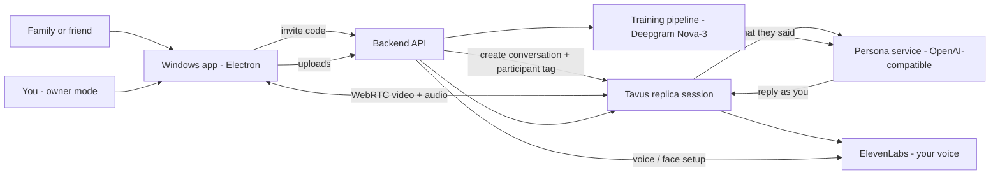

# cloneME (TheOtherMe)

A Windows app where family and friends have a live face-to-face conversation with an AI version of you: your face, your voice, the way you talk, and a separate memory of each person.



| Part | Where | What it does |
| --- | --- | --- |
| Backend API | `server/src/app.ts`, `routes/` | Invite-code sign-in, session broker, owner API. **Holds every vendor key.** |
| Persona service | `server/src/persona/` | `POST /v1/chat/completions` (OpenAI-compatible, streaming). Tavus calls it as the custom LLM. Profile + style pack + per-person memory + avoid-topic guard. |
| Vendor clients | `server/src/vendors/` | Tavus, ElevenLabs (PVC), Deepgram (Nova-3), any OpenAI-compatible LLM. Each has a real client and a mock. |
| Setup | `server/src/setup.ts`, `server/src/cli.ts` | Create the ElevenLabs voice clone, Tavus replica and Tavus persona (voice wired in). |
| Training | `server/src/training/` | Deepgram transcription, owner-speaker selection, style and fact extraction, persona refresh. |
| Windows app | `desktop/` | Electron app (NSIS installer, auto-update). Never sees an API key. |
| Latency | `server/src/scripts/measureLatency.ts` | `npm run measure:latency` |

## Quick start (everything in mock mode, no keys needed)

Requires Node 20+ (22 recommended).

```bash
npm install
npm test                      # backend, persona, training pipeline, desktop
cp server/.env.example server/.env   # optional; mock mode needs no edits
MOCK_MODE=true OWNER_INVITE_CODE=OWNR-TEST-CODE OWNER_NAME="Your Name" npm run dev:server
CLONEME_API_URL=http://localhost:8787 npm run dev:desktop   # in another terminal
```

Sign in with `OWNR-TEST-CODE`, press **Talk**, and use **Text** to chat. In mock mode there is no live video; the persona replies come from a deterministic stand-in. Any vendor whose key is missing runs in mock mode automatically, so you can switch vendors on one at a time. `GET /healthz` and Owner mode > Overview show which are live.

## Environment variables

All of these are read by the **server**. The desktop app only needs `CLONEME_API_URL` (baked in at build time, see below). See `server/.env.example`.

| Variable | Secret | Purpose |
| --- | --- | --- |
| `TAVUS_API_KEY` | yes | Tavus replicas, personas, conversations |
| `ELEVENLABS_API_KEY` | yes | Voice clone; also handed to Tavus so it can speak with your voice |
| `DEEPGRAM_API_KEY` | yes | Nova-3 transcription for training |
| `LLM_API_KEY` | yes | The model behind the persona (any OpenAI-compatible API) |
| `LLM_BASE_URL`, `LLM_MODEL` | no | Defaults: `https://api.openai.com/v1`, `gpt-4o` |
| `SESSION_SECRET` | yes | >= 32 chars; signs app tokens and media links. Required when `NODE_ENV=production` |
| `PERSONA_LLM_SHARED_SECRET` | yes | >= 24 chars; Tavus sends it as the Bearer key to `/v1`. Required in production |
| `PUBLIC_BASE_URL` | no | Public HTTPS URL of the server (Tavus calls `${PUBLIC_BASE_URL}/v1`) |
| `OWNER_NAME`, `OWNER_INVITE_CODE` | code: yes | Owner account. Without a code one is generated and printed once at first start |
| `TAVUS_REPLICA_ID`, `TAVUS_PERSONA_ID`, `ELEVENLABS_VOICE_ID` | no | Written by the setup step; set to pin them |
| `TAVUS_WEBHOOK_SECRET` | yes | Optional; protects `/webhooks/tavus` |
| `MAX_CONCURRENT_SESSIONS`, `MAX_CALL_SECONDS`, `MAX_UPLOAD_MB`, `DATA_DIR`, `PORT`, `MOCK_MODE` | no | Cost caps and plumbing |

Never commit keys. `.env` is git-ignored; on a host, use its secret manager.

## Going live, step by step

1. **Accounts and keys.** Create Tavus, ElevenLabs (plan with Professional Voice Cloning), Deepgram and an LLM provider account. Put the four keys in the server's secret store.
2. **Deploy the server** (any Node host with HTTPS and a persistent disk for `DATA_DIR`, for example Fly.io, Render or a small VM). `npm run build -w server && npm start -w server` with `NODE_ENV=production` and the env vars above. Copy the owner invite code from the first start log. Back up `DATA_DIR`.
3. **Install the app and sign in** as owner (build it first, see "Windows installer").
4. **Owner mode > Profile.** Fill in "About you", family and "never talk about" topics.
5. **Owner mode > Upload.**
   - *Voice samples*: 30+ minutes of clean speech.
   - *Face training video*: about 2 minutes on camera. *Consent video*: you speaking Tavus's consent statement.
   - *Style training*: more audio/video of you talking, plus texts, emails or notes in your voice.
6. **Owner mode > Overview**, in order: *Create/refresh voice*, then *Create/refresh face*, wait for both to finish (Overview shows status; ElevenLabs may require completing voice verification in its dashboard before *Start voice training* works), then *Link persona*. Same steps from a shell: `npm run setup:voice`, `setup:replica`, `setup:persona` (run where `DATA_DIR` and env are available; `npm run cli -w server -- help` lists everything).
7. **Refresh persona from uploads** (Overview). Review **Learned style**: approve or reject extracted facts (only approved facts are used in conversation).
8. **People:** add each person, privately send them their invite code once (it cannot be shown again). Friends get the "AI version of ..." banner by default; family do not. Toggle per person. Revoke cuts access immediately and ends their call.
9. **Pilot checks:** run `npm run measure:latency` (below) and do a real call yourself as owner first.

Uploading more media later and pressing **Refresh persona** updates style and facts. Voice/face refresh creates a new clone and is a manual action because it costs money.

## Windows installer and auto-update

```bash
CLONEME_API_URL=https://cloneme.example.com npm run build:desktop   # installer in desktop/release/
```

Build the real installer on Windows (the `Release Windows app` GitHub Action does this on a `v*` tag). Linux/macOS can package the unpacked app but cannot finish the NSIS installer without Wine.

- **Code signing:** set `CSC_LINK` (path, URL or base64 of your `.pfx`) and `CSC_KEY_PASSWORD`; in CI use the `WIN_CSC_LINK` and `WIN_CSC_KEY_PASSWORD` secrets. Unsigned installers work but Windows SmartScreen will warn your family.
- **Auto-update:** `electron-updater` checks GitHub Releases for `chamgam210-del/TheOtherMe` (`desktop/electron-builder.yml`). Tag `v0.1.1` etc.; the workflow publishes the installer plus `latest.yml`. Installs are per-user (no admin prompt) so silent updates work. If the repo is private, releases need a token the app can read, so use a public releases repo or a generic update URL instead.
- **API URL:** `CLONEME_API_URL` is baked into `dist/config.json` at build time (GitHub variable `CLONEME_API_URL` in CI); end users can override it with the same environment variable.

## How the pieces fit

- **Sign-in:** invite codes are 12 random characters, stored hashed, exchanged for a signed 30-day token that the app keeps encrypted with Windows DPAPI. Redeem attempts are rate limited. Revoking someone invalidates their token immediately.
- **Sessions:** `POST /api/sessions` creates a Tavus conversation with `memory_stores: ["p_<personId>"]` (the per-person participant tag), a personalised greeting, a call time limit and a global concurrency cap. The app joins the returned Daily room URL for WebRTC.
- **Persona (Tavus custom LLM):** the Tavus persona is created with `layers.llm.base_url = ${PUBLIC_BASE_URL}/v1` and `api_key = PERSONA_LLM_SHARED_SECRET`. The conversational context carries a `[[cloneme:person=<id>]]` marker; the persona service reads it to load that person's memory and ignores Tavus's own system prompt. Unknown people get no memory. Replies are filtered sentence by sentence against the avoid-topics list before they are spoken. The prompt tells the model to admit it is an AI version if sincerely asked and not to invent facts.
- **Memory:** per person, kept only for that person: recent turns, notes extracted from what they say, and an LLM summary at call end (when a real LLM is configured). The owner can clear a person's memory.
- **Training:** audio/video go to Deepgram Nova-3 with diarization; your speaker is the one who talks most (or pin it per file via the API's `ownerSpeaker`). Style pack = sentence length, contractions, fillers, openers, signature phrases, example lines (plus an LLM description when available). Facts start as `pending` for your review.
- **Data:** a JSON file store under `DATA_DIR` (people, profile, style, facts, memories, media). Fine for a pilot of a few people; swap `store.ts` for a database before wider use.

## Latency measurement

```bash
npm run measure:latency -- --runs 10                      # in-process mock stack: backend overhead only
npm run measure:latency -- --url https://cloneme.example.com --code <friend invite code> --persona-secret <PERSONA_LLM_SHARED_SECRET> --runs 20
```

It reports p50/p95 for session creation, persona time to first token and full reply, ElevenLabs time to first audio byte (when the key and voice id are in the environment of an in-process run), and an estimated "clone starts replying" time (target 0.75 to 1 s). Without the persona secret it measures the text-fallback endpoint instead. Tavus-side speech-end detection and avatar rendering are not visible to the script: for the real end-to-end number, record a call (screen + audio) and time from the end of your sentence to the first sound of the reply, about 10 times, and compare with the script's estimate. The plan budgets about 0.15 s of avatar video on top.

## Tests

`npm test` runs `server/test` (auth, broker, owner API, persona endpoint, memory isolation, avoid-topics, training pipeline, vendor request shapes, latency script) and `desktop/test` (API layer against the real backend, token store, UI flows in jsdom). `npm run typecheck` checks both packages. CI runs the same on every PR.

## Assumptions to check against live vendors

The vendor clients follow the public docs but could not be run against real accounts yet. When keys arrive, verify:

1. Tavus persona `layers.llm`/`layers.tts` field names and that `conversational_context` reaches the custom LLM as a system message (the `[[cloneme:person=...]]` marker relies on this; `x-cloneme-person` header is a fallback).
2. `memory_stores` on conversation creation behaves as the per-person memory tag.
3. ElevenLabs PVC: verification step and the `fine_tuning.state` values used to report voice status.
4. Daily room CSP in `desktop/src/renderer/index.html` (Daily loads scripts and connects to several `daily.co` hosts); loosen only if the call fails to connect.
5. Electron `safeStorage.isEncryptionAvailable` is deprecated in Electron 45; migrate to the async variants before it is removed.

## Out of scope for v1

Mac/mobile, Zoom/Teams, public use, live learning during calls (learning happens from uploads).
