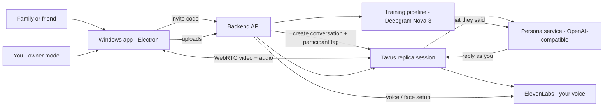

# cloneME (TheOtherMe)

A Windows app where family and friends have a live face-to-face conversation with an AI version of you: your face, your voice, the way you talk, and a separate memory of each person.



| Part | Where | What it does |
| --- | --- | --- |
| Backend API | `server/src/app.ts`, `routes/` | Invite-code sign-in, session broker, owner API. **Holds every vendor key.** |
| Persona service | `server/src/persona/` | `POST /v1/chat/completions` (OpenAI-compatible, streaming). Tavus calls it as the custom LLM. Profile + style pack + per-person memory + avoid-topic guard. |
| Vendor clients | `server/src/vendors/` | Tavus, ElevenLabs (PVC), Deepgram (Nova-3), any OpenAI-compatible LLM. Each has a real client and a mock. |
| Setup | `server/src/setup.ts`, `server/src/cli.ts` | Create the ElevenLabs voice clone, Tavus replica and Tavus persona (voice wired in). |
| Training | `server/src/training/` | Deepgram transcription, owner-speaker selection, style and fact extraction, persona refresh. |
| Windows app | `desktop/` | Electron app (NSIS installer, auto-update) with the guided setup wizard (`desktop/src/renderer/wizard/`, state machine in `desktop/src/shared/wizard.ts`). Keys are tested in memory and stored on the server only. |
| Latency | `server/src/scripts/measureLatency.ts` | `npm run measure:latency` |

## Quick start (everything in mock mode, no keys needed)

Requires Node 20+ (22 recommended).

```bash
npm install
npm test                      # backend, persona, training pipeline, desktop
cp server/.env.example server/.env   # optional; mock mode needs no edits
MOCK_MODE=true OWNER_INVITE_CODE=OWNR-TEST-CODE OWNER_NAME="Your Name" npm run dev:server
CLONEME_API_URL=http://localhost:8787 npm run dev:desktop   # in another terminal
```

To see the guided setup instead, start the server unclaimed (`MOCK_MODE=true SETUP_TOKEN=any-long-token npm run dev:server`), open the app, press **Set up my own AI self**, use `http://localhost:8787` and that token in step 3. Add `MOCK_REQUIRE_VERIFICATION=true` to see the ElevenLabs verification pause in the build step. Plain `http` is only accepted for a server on the same computer.

Otherwise sign in with `OWNR-TEST-CODE`, press **Talk**, and use **Text** to chat. In mock mode there is no live video; the persona replies come from a deterministic stand-in. Any vendor whose key is missing runs in mock mode automatically, so you can switch vendors on one at a time. `GET /healthz` and Owner mode > Overview show which are live.

## Environment variables

All of these are read by the **server**. With the guided setup the owner never has to touch them (the Render blueprint sets what is needed, and the app saves keys). The desktop app only needs `CLONEME_API_URL` for friends' installers (baked in at build time, see below); owners choose their server in step 3. See `server/.env.example`.

| Variable | Secret | Purpose |
| --- | --- | --- |
| `TAVUS_API_KEY` | yes | Tavus replicas, personas, conversations |
| `ELEVENLABS_API_KEY` | yes | Voice clone; also handed to Tavus so it can speak with your voice |
| `DEEPGRAM_API_KEY` | yes | Nova-3 transcription for training |
| `LLM_API_KEY` | yes | The model behind the persona (any OpenAI-compatible API) |
| `LLM_BASE_URL`, `LLM_MODEL` | no | Defaults: `https://api.openai.com/v1`, `gpt-4o` |
| `SESSION_SECRET` | yes | >= 32 chars; signs app tokens and media links; also the vault key. Generated and stored on the server when not set |
| `PERSONA_LLM_SHARED_SECRET` | yes | >= 24 chars; Tavus sends it as the Bearer key to `/v1`. Generated and stored when not set |
| `PUBLIC_BASE_URL` | no | Public HTTPS URL of the server (Tavus calls `${PUBLIC_BASE_URL}/v1`); falls back to Render's `RENDER_EXTERNAL_URL` |
| `SETUP_TOKEN` | yes | Lets the first person who knows it claim an unclaimed server from the app (one time) |
| `PERSISTENT_STORAGE` | no | Set `true` when `DATA_DIR` is on a persistent disk; reported to the app in step 3 |
| `INSTALLER_URL` | no | Link put in invite messages (default: latest GitHub release) |
| `MOCK_REQUIRE_VERIFICATION` | no | Mock mode only: simulate ElevenLabs asking for manual voice verification |
| `OWNER_NAME`, `OWNER_INVITE_CODE` | code: yes | Owner account. Without a code one is generated and printed once at first start |
| `TAVUS_REPLICA_ID`, `TAVUS_PERSONA_ID`, `ELEVENLABS_VOICE_ID` | no | Written by the setup step; set to pin them |
| `TAVUS_WEBHOOK_SECRET` | yes | Optional; protects `/webhooks/tavus` |
| `MAX_CONCURRENT_SESSIONS`, `MAX_CALL_SECONDS`, `MAX_UPLOAD_MB`, `DATA_DIR`, `PORT`, `MOCK_MODE` | no | Cost caps and plumbing |

Never commit keys. `.env` is git-ignored; on a host, use its secret manager.

## Setting up your own AI self (guided, inside the app)

Every go-live item is a step in the app's setup guide, so a new owner needs no docs and no developer. The guide opens from **Set up my own AI self** on the sign-in screen (and again any time from **Setup guide** on the owner's home screen, where every step can be reopened). Progress is saved after each action and the guide resumes where you stopped; a step's **Next** button stays disabled, with the reason shown, until its checks pass.

| # | Step | What the owner does | What the app checks |
| --- | --- | --- | --- |
| 1 | Welcome | Reads what is built, what is stored where, ticks the consent box, types their legal name | Box ticked, name entered (the name goes into the consent statement) |
| 2 | Accounts and keys | Follows the links to create Tavus, ElevenLabs (PVC plan), Deepgram and LLM accounts, pastes each key | Each key is tested with a real request to the vendor; ElevenLabs plans without Professional Voice Cloning are flagged |
| 3 | Your server | Presses **Create my server on Render**, pastes the server address and the `SETUP_TOKEN` | `/healthz` shows online, https, persistent storage, claimable; the token claims the server and the owner code is shown once |
| 4 | Record your voice | Reads 10 passages and answers 14 story questions in the app | Per-clip level, noise floor, clipping and silence checks; re-record any clip; 30:00 total required; resumable |
| 5 | Record your face | Records about 2 minutes with an on-screen script | Oval framing guide, live lighting check, playback and re-take; at least 1:30 |
| 6 | Consent video | Records the Tavus consent statement shown on screen | Statement built from the owner's name; at least 8 s |
| 7 | More material (optional) | Adds existing recordings, videos, photos, texts | Voice files count toward the 30 minutes |
| 8 | About you | Answers a questionnaire and lists family and friends | Three required answers |
| 9 | Topics to avoid | Picks or adds topics, or ticks "nothing to avoid" | An explicit choice |
| 10 | Invite people | Adds people, gets a private code and a ready-to-send message | At least one person, or "later" |
| 11 | Build your AI self | Presses Start | Live status for transcription, voice clone, ElevenLabs verification (manual, with instructions and an "I've verified my voice" button), face replica, persona; failed stages can be retried |
| 12 | Test call | Talks to their own AI self, then **Finish setup** | At least one completed test call |

### Hosting choice: Render one-click blueprint

The simplest path for a non-technical owner is [Render](https://render.com) using `render.yaml` and the root `Dockerfile`: press one button, accept the Starter plan, wait a few minutes. The blueprint gives the service a public https address, a persistent disk for `DATA_DIR`, generated `SESSION_SECRET` and `PERSONA_LLM_SHARED_SECRET`, and a generated `SETUP_TOKEN`. Render's Starter plan plus the 10 GB disk is roughly $10 a month (check Render's current pricing). The owner proves it is their server by pasting that `SETUP_TOKEN` into the app; the first valid claim creates the owner account and then claiming is closed (`409`), so nobody else can take over a fresh server. Re-signing in later uses the owner code shown once at claim time. The deploy button URL lives in `desktop/src/shared/prompts.ts` (`DEPLOY_URL`); point it at your fork if you maintain one.

Other hosts work too: any host that runs the `Dockerfile` with the env vars below and a persistent `DATA_DIR`.

### Where keys live

Keys pasted in step 2 are tested by the desktop app's main process. Until the server exists they are held only in that process's memory, never written to disk or shown to the page again; when the server is claimed they are sent over https to `PUT /api/owner/keys`, which re-tests them and stores them encrypted (AES-256-GCM, key derived from `SESSION_SECRET`) in `DATA_DIR/secrets.enc.json`. Environment variables, if set, still work and are used when no app-saved key exists. Keys are never returned by any endpoint.

### Developer fallback

You can still run things from a shell (`npm run setup:voice`, `setup:replica`, `setup:persona`; `npm run cli -w server -- help`), and Owner mode > Upload / Overview remain for later changes.

## Windows installer and auto-update

```bash
CLONEME_API_URL=https://cloneme.example.com npm run build:desktop   # installer in desktop/release/
```

Build the real installer on Windows (the `Release Windows app` GitHub Action does this on a `v*` tag). Linux/macOS can package the unpacked app but cannot finish the NSIS installer without Wine.

- **Code signing:** set `CSC_LINK` (path, URL or base64 of your `.pfx`) and `CSC_KEY_PASSWORD`; in CI use the `WIN_CSC_LINK` and `WIN_CSC_KEY_PASSWORD` secrets. Unsigned installers work but Windows SmartScreen will warn your family.
- **Auto-update:** `electron-updater` checks GitHub Releases for `chamgam210-del/TheOtherMe` (`desktop/electron-builder.yml`). Tag `v0.1.1` etc.; the workflow publishes the installer plus `latest.yml`. Installs are per-user (no admin prompt) so silent updates work. If the repo is private, releases need a token the app can read, so use a public releases repo or a generic update URL instead.
- **API URL:** `CLONEME_API_URL` is baked into `dist/config.json` at build time (GitHub variable `CLONEME_API_URL` in CI); end users can override it with the same environment variable.

## How the pieces fit

- **Sign-in:** invite codes are 12 random characters, stored hashed, exchanged for a signed 30-day token that the app keeps encrypted with Windows DPAPI. Redeem attempts are rate limited. Revoking someone invalidates their token immediately.
- **Sessions:** `POST /api/sessions` creates a Tavus conversation with `memory_stores: ["p_<personId>"]` (the per-person participant tag), a personalised greeting, a call time limit and a global concurrency cap. The app joins the returned Daily room URL for WebRTC.
- **Persona (Tavus custom LLM):** the Tavus persona is created with `layers.llm.base_url = ${PUBLIC_BASE_URL}/v1` and `api_key = PERSONA_LLM_SHARED_SECRET`. The conversational context carries a `[[cloneme:person=<id>]]` marker; the persona service reads it to load that person's memory and ignores Tavus's own system prompt. Unknown people get no memory. Replies are filtered sentence by sentence against the avoid-topics list before they are spoken. The prompt tells the model to admit it is an AI version if sincerely asked and not to invent facts.
- **Memory:** per person, kept only for that person: recent turns, notes extracted from what they say, and an LLM summary at call end (when a real LLM is configured). The owner can clear a person's memory.
- **Training:** audio/video go to Deepgram Nova-3 with diarization; your speaker is the one who talks most (or pin it per file via the API's `ownerSpeaker`). Style pack = sentence length, contractions, fillers, openers, signature phrases, example lines (plus an LLM description when available). Facts start as `pending` for your review.
- **Data:** a JSON file store under `DATA_DIR` (people, profile, style, facts, memories, media). Fine for a pilot of a few people; swap `store.ts` for a database before wider use.

## Latency measurement

```bash
npm run measure:latency -- --runs 10                      # in-process mock stack: backend overhead only
npm run measure:latency -- --url https://cloneme.example.com --code <friend invite code> --persona-secret <PERSONA_LLM_SHARED_SECRET> --runs 20
```

It reports p50/p95 for session creation, persona time to first token and full reply, ElevenLabs time to first audio byte (when the key and voice id are in the environment of an in-process run), and an estimated "clone starts replying" time (target 0.75 to 1 s). Without the persona secret it measures the text-fallback endpoint instead. Tavus-side speech-end detection and avatar rendering are not visible to the script: for the real end-to-end number, record a call (screen + audio) and time from the end of your sentence to the first sound of the reply, about 10 times, and compare with the script's estimate. The plan budgets about 0.15 s of avatar video on top.

## Tests

`npm test` runs `server/test` (auth, broker, owner API, key vault and verification, setup-token claim, guided build, persona endpoint, memory isolation, avoid-topics, training pipeline, vendor request shapes, latency script) and `desktop/test` (API layer and onboarding handlers against the real backend, token store, wizard state machine and validation, audio/video quality analysis, invite parsing, and the whole wizard flow in jsdom with fake recorders). `npm run typecheck` checks both packages. CI runs the same on every PR.

## Assumptions to check against live vendors

The vendor clients follow the public docs but could not be run against real accounts yet. When keys arrive, verify:

1. Tavus persona `layers.llm`/`layers.tts` field names and that `conversational_context` reaches the custom LLM as a system message (the `[[cloneme:person=...]]` marker relies on this; `x-cloneme-person` header is a fallback).
2. `memory_stores` on conversation creation behaves as the per-person memory tag.
3. ElevenLabs PVC: verification step and the `fine_tuning.state` values used to report voice status.
4. Daily room CSP in `desktop/src/renderer/index.html` (Daily loads scripts and connects to several `daily.co` hosts); loosen only if the call fails to connect.
5. Electron `safeStorage.isEncryptionAvailable` is deprecated in Electron 45; migrate to the async variants before it is removed.
6. The Tavus consent statement text in `CONSENT_TEMPLATE` (`desktop/src/shared/prompts.ts`) is the wording from Tavus's docs; confirm it against the current docs before the first real replica.
7. In-app videos are recorded by Chromium as WebM (VP9/Opus). Confirm Tavus accepts WebM for `train_video_url` and `consent_video_url`; if it requires MP4, add an ffmpeg conversion in the server's replica step (the recording is stored unchanged).
8. The vendor key checks use read-only endpoints (`GET /v2/replicas`, `/v1/user/subscription`, `/v1/projects`, `/models`); verify each accepts a restricted key. The ElevenLabs `can_use_professional_voice_cloning` flag drives the plan warning.
9. The ElevenLabs verification instructions (Voices > your voice > Verify) follow their PVC docs and may need wording changes if their dashboard differs.
10. The Render blueprint (`render.yaml`) and button URL need a first real deploy to confirm plan names, disk size and that the generated `SETUP_TOKEN` is visible to the owner.

## Out of scope for v1

Mac/mobile, Zoom/Teams, public use, live learning during calls (learning happens from uploads).
